# Logical Record Structure (LRS) - SynFit

Dokumen ini mendefinisikan struktur rekaman logis (Logical Record Structure) untuk database Cloud Firestore yang digunakan pada aplikasi **SynFit**. Mengingat Firestore adalah database NoSQL berorientasi dokumen, LRS digambarkan secara logis melalui hubungan relasional antar-koleksi utama.

---

## 📊 Diagram Hubungan LRS (ERD / LRS Diagram)

Berikut adalah diagram relasi antar-entitas (Entity Relationship) pada database Firestore SynFit menggunakan notasi kaki gagak (Crow's Foot):

```mermaid
erDiagram
    USERS {
        string id PK "Document ID"
        string uid "Firebase Auth UID"
        string name "Nama Lengkap Staf"
        string username "Username Login"
        string email "Email Staf"
        string role "Admin | Owner"
        string status "Pending Verification | Verified"
        string lastLogin "Never | Last Login Time"
        timestamp created_at "Tanggal Registrasi"
        string photoUrl "URL Foto Profil"
    }

    MEMBERS {
        string id PK "Document ID (member_id)"
        string nama "Nama Lengkap Member"
        string nomor_whatsapp "Nomor WA (Login ID)"
        string alamat "Alamat Rumah"
        string membership_type "1 Bulan | 3 Bulan"
        string status "Active | Expired | Suspended"
        string tanggal_daftar "YYYY-MM-DD"
        string tanggal_expired "YYYY-MM-DD"
        string qr_token "Token QR Check-in"
        timestamp created_at "Tanggal Pembuatan"
        string foto_url "URL Foto Profil Member"
    }

    MEMBER_ACCOUNTS {
        string id PK "Document ID"
        string member_id FK "Relasi ke MEMBERS.id"
        string nama "Nama Lengkap"
        string nomor_whatsapp "Nomor WA Member"
        string password "Kata Sandi Akun"
    }

    REGISTRATIONS {
        string id PK "Document ID"
        string member_id FK "Relasi ke MEMBERS.id (Optional)"
        string nama "Nama Pendaftar"
        string nomor_whatsapp "Nomor WA Pendaftar"
        string alamat "Alamat Pendaftar"
        string membership_type "1 Bulan | 3 Bulan"
        number amount "Nominal Pembayaran"
        string payment_method "QRIS | Cash"
        string bukti_pembayaran "URL Foto Bukti Transfer"
        string status "Pending | Approved | Rejected"
        boolean is_renewal "Penanda Perpanjangan"
        timestamp created_at "Waktu Pengajuan"
    }

    CHECKINS {
        string id PK "Document ID"
        string member_id FK "Relasi ke MEMBERS.id (Optional)"
        string member_name "Nama Member/Pengunjung"
        string qr_token "Token QR yang Di-scan"
        string status "Success | Failed"
        string type "Member Check-in | Daily Visitor"
        string scan_date "DD/MM/YYYY"
        timestamp scanned_at "Waktu Presisi Check-in"
    }

    CONFIGS {
        string id PK "Document ID ('gym')"
        number latitude "Latitude GPS Gym"
        number longitude "Longitude GPS Gym"
        number radius "Radius Maksimal (Meter)"
        string qris_image_url "URL QRIS Code Image"
    }

    CHATS {
        string id PK "Document ID"
        string sender_id "Email / ID Pengirim"
        string sender_name "Nama Pengirim"
        string sender_role "Role Pengirim"
        string sender_photo "URL Foto Pengirim"
        string content "Teks Obrolan"
        string image_url "URL Lampiran Gambar"
        boolean is_deleted "Status Penghapusan"
        timestamp created_at "Waktu Kirim"
    }

    MEMBER_CHATS {
        string id PK "Document ID"
        string member_id FK "Relasi ke MEMBERS.id"
        string sender_id "Email Admin / ID Member"
        string sender_name "Nama Pengirim"
        string sender_role "ADMIN | MEMBER"
        string content "Teks Obrolan"
        string image_url "URL Lampiran Gambar"
        timestamp created_at "Waktu Kirim"
    }

    NOTIFICATIONS {
        string id PK "Document ID"
        string member_id FK "Relasi ke MEMBERS.id"
        string title "Judul Notifikasi"
        string body "Isi Pesan"
        boolean is_read "Status Dibaca Member"
        timestamp created_at "Waktu Kirim"
    }

    EQUIPMENT {
        string id PK "Document ID"
        string equipId "Kode Serial Alat (EQ-XXXX)"
        string name "Nama Peralatan"
        string category "Cardio | Strength | Weights"
        string condition "Good | Warning | Critical"
        number age "Umur Ekonomis Alat (Tahun)"
        string lastMaintenance "YYYY-MM-DD"
        string photoUrl "URL Foto Peralatan"
        timestamp created_at "Waktu Input Alat"
        number kerusakan "SAW C1: Nilai Kerusakan (1-5)"
        number pemakaian "SAW C2: Nilai Intensitas Pakai (1-5)"
        number economic_age "SAW C3: Nilai Umur Ekonomis (1-5)"
        number biaya "SAW C4: Estimasi Biaya (1-5)"
        number risiko "SAW C5: Risiko Kegagalan (1-5)"
        string deskripsi "Catatan Kerusakan Evaluator"
    }

    TRANSACTIONS {
        string id PK "Document ID"
        string member "Nama Lengkap Pembayar"
        string type "New Registration | Membership Renewal | Daily Visitor"
        number amount "Nominal Transaksi"
        string method "Cash | QRIS"
        string status "Success | Failed"
        string date "Tanggal Transaksi Terformat"
        timestamp created_at "Waktu Pembukuan"
    }

    MEMBERS ||--|| MEMBER_ACCOUNTS : "memiliki kredensial login"
    MEMBERS ||--o| REGISTRATIONS : "mengajukan perpanjangan"
    MEMBERS ||--o{ CHECKINS : "melakukan log absensi"
    MEMBERS ||--o{ MEMBER_CHATS : "berinteraksi di chat thread"
    MEMBERS ||--o{ NOTIFICATIONS : "menerima log"
```

---

## 🗂️ Detail Kamus Data Koleksi (Data Dictionary)

Berikut adalah rincian skema untuk masing-masing koleksi pada Cloud Firestore:

### 1. `users` (Staf Internal & Admin)
Menyimpan data otorisasi dan profil dari staf admin dan pemilik (Owner) gym.

| Nama Field | Tipe Data | Deskripsi | Keterangan |
| :--- | :--- | :--- | :--- |
| `id` | `String` | Document ID Firestore (Auto-generated) | **Primary Key** |
| `uid` | `String` | Auth User ID dari Firebase Authentication | Penghubung ke Firebase Auth |
| `name` | `String` | Nama lengkap admin/staf | |
| `username`| `String` | Username unik untuk login | |
| `email` | `String` | Alamat email terdaftar | |
| `role` | `String` | Hak akses sistem | `"Admin"` atau `"Owner"` |
| `status` | `String` | Status verifikasi email akun staf | `"Pending Verification"`, `"Verified"` |
| `lastLogin`| `String` | Log login terakhir ke sistem | Format string tanggal atau `"Never"` |
| `created_at`| `Timestamp`| Waktu pembuatan akun staf | |
| `photoUrl` | `String` | URL foto profil (Cloudinary) | *Optional* |
| `settings` | `Map` | Konfigurasi notifikasi akun | *Optional* |
| `settings.emailNotifications` | `Boolean` | Notifikasi status registrasi via email | Default: `true` |
| `settings.maintenanceAlerts` | `Boolean` | Notifikasi alarm kerusakan alat (SAW) | Default: `true` |

---

### 2. `members` (Data Keanggotaan Member Gym)
Menyimpan data utama profil member gym yang aktif.

| Nama Field | Tipe Data | Deskripsi | Keterangan |
| :--- | :--- | :--- | :--- |
| `id` | `String` | Document ID Firestore (Auto-generated) | **Primary Key** (sebagai `member_id` di koleksi lain) |
| `nama` | `String` | Nama lengkap member | |
| `nomor_whatsapp` | `String` | Nomor telepon WhatsApp aktif | Berfungsi sebagai ID login member |
| `alamat` | `String` | Alamat tempat tinggal | |
| `membership_type` | `String` | Durasi keanggotaan paket | `"1 Bulan"`, `"3 Bulan"` |
| `status` | `String` | Status member aktif | `"Active"`, `"Expired"`, `"Suspended"` |
| `tanggal_daftar` | `String` | Tanggal pendaftaran keanggotaan | Format: `"YYYY-MM-DD"` |
| `tanggal_expired` | `String` | Tanggal kedaluwarsa keanggotaan | Format: `"YYYY-MM-DD"` |
| `qr_token` | `String` | Token unik untuk scan QR Code check-in | Format: `"AR-XXXXXX"` |
| `created_at`| `Timestamp`| Waktu pembuatan data member | |
| `foto_url` | `String` | URL foto profil member | *Optional* |

---

### 3. `member_accounts` (Kredensial Login Member)
Menyimpan data password login member untuk mengakses portal digital card dan dashboard member.

| Nama Field | Tipe Data | Deskripsi | Keterangan |
| :--- | :--- | :--- | :--- |
| `id` | `String` | Document ID Firestore (Auto-generated) | **Primary Key** |
| `member_id` | `String` | ID dokumen member | **Foreign Key** -> `members.id` |
| `nama` | `String` | Nama lengkap member (denormalisasi) | |
| `nomor_whatsapp` | `String` | Nomor WA login member (denormalisasi) | |
| `password` | `String` | Kata sandi login portal member | Default: `"areta123"` |

---

### 4. `registrations` (Registrasi & Renewal Pending Approvals)
Pendaftaran member baru atau permohonan perpanjangan yang diajukan pelanggan lewat aplikasi. Menunggu approval admin.

| Nama Field | Tipe Data | Deskripsi | Keterangan |
| :--- | :--- | :--- | :--- |
| `id` | `String` | Document ID Firestore (Auto-generated) | **Primary Key** |
| `member_id` | `String` | ID dokumen member lama | **Foreign Key** -> `members.id` (*Hanya jika `is_renewal` = `true`*) |
| `nama` | `String` | Nama pendaftar | |
| `nomor_whatsapp` | `String` | Nomor WhatsApp pendaftar | |
| `alamat` | `String` | Alamat tempat tinggal | |
| `membership_type` | `String` | Paket keanggotaan yang diajukan | `"1 Bulan"`, `"3 Bulan"` |
| `amount` | `Number` | Nominal biaya paket keanggotaan | e.g. `160000`, `480000` |
| `payment_method` | `String` | Cara transaksi pembayaran | `"QRIS"`, `"Cash"` |
| `bukti_pembayaran` | `String` | URL bukti transaksi pembayaran (Cloudinary) | *Optional* (diunggah jika lewat transfer QRIS) |
| `status` | `String` | Status persetujuan pengajuan | `"Pending"`, `"Approved"`, `"Rejected"` |
| `is_renewal` | `Boolean` | Penanda perpanjangan member lama | |
| `created_at`| `Timestamp`| Waktu pengiriman formulir pendaftaran | |

---

### 5. `checkins` (Log Presensi Harian / Check-in)
Menyimpan log harian aktivitas check-in di gym menggunakan GPS.

| Nama Field | Tipe Data | Deskripsi | Keterangan |
| :--- | :--- | :--- | :--- |
| `id` | `String` | Document ID Firestore (Auto-generated) | **Primary Key** |
| `member_id` | `String` | ID member yang melakukan check-in | **Foreign Key** -> `members.id` (*Kosong jika Daily Visitor*) |
| `member_name` | `String` | Nama pengunjung/member | |
| `qr_token` | `String` | Token QR yang digunakan check-in | *Kosong jika Daily Visitor* |
| `status` | `String` | Status keberhasilan check-in | `"Success"`, `"Failed"` |
| `type` | `String` | Kategori kedatangan | `"Member Check-in"`, `"Daily Visitor"` |
| `scan_date` | `String` | Tanggal check-in terformat | Format: `"DD/MM/YYYY"` |
| `scanned_at`| `Timestamp`| Waktu detail check-in tersimpan | |

---

### 6. `configs` (Konfigurasi Aplikasi & GPS Gym)
Menyimpan pengaturan parameter global untuk operasional gym. Koleksi ini hanya memiliki 1 dokumen utama bernama `"gym"`.

| Nama Field | Tipe Data | Deskripsi | Keterangan |
| :--- | :--- | :--- | :--- |
| `id` | `String` | Document ID (Bernilai `"gym"`) | **Primary Key** |
| `latitude` | `Number` | Titik koordinat garis lintang gym | Untuk pencocokan jarak GPS |
| `longitude`| `Number` | Titik koordinat garis bujur gym | Untuk pencocokan jarak GPS |
| `radius` | `Number` | Radius toleransi check-in GPS (Meter) | Default: `30` |
| `qris_image_url`| `String`| URL foto QRIS Pembayaran resmi gym | |

---

### 7. `chats` (Obrolan Internal Staf Gym)
Menyimpan pesan percakapan grup/internal sesama tim staf admin dan owner gym.

| Nama Field | Tipe Data | Deskripsi | Keterangan |
| :--- | :--- | :--- | :--- |
| `id` | `String` | Document ID Firestore (Auto-generated) | **Primary Key** |
| `sender_id` | `String` | Email pengirim pesan | |
| `sender_name`| `String` | Nama lengkap pengirim pesan | |
| `sender_role`| `String` | Peran pengirim pesan | `"Admin"`, `"Owner"`, `"Developer"` |
| `sender_photo`| `String`| URL foto profil pengirim | *Optional* |
| `content` | `String` | Teks pesan obrolan | |
| `image_url` | `String` | URL gambar lampiran di chat (Cloudinary) | *Optional* |
| `is_deleted`| `Boolean` | Penanda status pesan telah dihapus | |
| `created_at`| `Timestamp`| Waktu pengiriman pesan | |

---

### 8. `member_chats` (Percakapan Direct Message Member-Admin)
Thread pesan pribadi antara member gym dengan staf/admin pelayanan pelanggan.

| Nama Field | Tipe Data | Deskripsi | Keterangan |
| :--- | :--- | :--- | :--- |
| `id` | `String` | Document ID Firestore (Auto-generated) | **Primary Key** |
| `member_id` | `String` | ID dokumen member terkait | **Foreign Key** -> `members.id` |
| `sender_id` | `String` | ID identifikasi pengirim pesan | Email admin atau ID member |
| `sender_name`| `String` | Nama lengkap pengirim | |
| `sender_role`| `String` | Peran pengirim pesan | `"ADMIN"` atau `"MEMBER"` |
| `content` | `String` | Teks isi pesan | |
| `image_url` | `String` | URL gambar lampiran di chat | *Optional* |
| `created_at`| `Timestamp`| Waktu pengiriman pesan | |

---

### 9. `notifications` (Log Notifikasi Push & In-App Member)
Menyimpan data riwayat notifikasi yang dikirimkan kepada member.

| Nama Field | Tipe Data | Deskripsi | Keterangan |
| :--- | :--- | :--- | :--- |
| `id` | `String` | Document ID Firestore (Auto-generated) | **Primary Key** |
| `member_id` | `String` | ID penerima notifikasi | **Foreign Key** -> `members.id` |
| `title` | `String` | Judul notifikasi | e.g. `"Check-in Berhasil"` |
| `body` | `String` | Deskripsi pesan notifikasi | |
| `is_read` | `Boolean` | Penanda status notifikasi telah dibaca | |
| `created_at`| `Timestamp`| Waktu pengiriman notifikasi | |

---

### 10. `equipment` (Inventaris & Penilaian SPK SAW Alat)
Menyimpan aset inventaris gym dan hasil rekam data kriteria untuk SPK (Sistem Pendukung Keputusan) perawatan mesin/alat gym dengan metode SAW (Simple Additive Weighting).

| Nama Field | Tipe Data | Deskripsi | Keterangan |
| :--- | :--- | :--- | :--- |
| `id` | `String` | Document ID Firestore (Auto-generated) | **Primary Key** |
| `equipId` | `String` | Kode serial/ID inventaris alat | Format: `"EQ-XXXX"` |
| `name` | `String` | Nama alat fitness | |
| `category` | `String` | Klasifikasi jenis latihan alat | `"Cardio"`, `"Strength"`, `"Free Weights"` |
| `condition` | `String` | Status kondisi operasional alat | `"Good"`, `"Warning"`, `"Critical"` |
| `age` | `Number` | Umur ekonomis fisik alat (Tahun) | |
| `lastMaintenance`| `String`| Tanggal perawatan berkala terakhir | Format: `"YYYY-MM-DD"` |
| `photoUrl` | `String` | URL foto alat (Cloudinary) | |
| `created_at`| `Timestamp`| Waktu pendaftaran alat | |
| `kerusakan` | `Number` | Kriteria C1: Tingkat Kerusakan | Skala input: `1` s/d `5` |
| `pemakaian` | `Number` | Kriteria C2: Intensitas Pemakaian Harian | Skala input: `1` s/d `5` |
| `economic_age`| `Number` | Kriteria C3: Umur Ekonomis Alat | Skala input: `1` s/d `5` |
| `biaya` | `Number` | Kriteria C4: Perkiraan Biaya Perawatan | Skala input: `1` s/d `5` |
| `risiko` | `Number` | Kriteria C5: Risiko Kerusakan Fatal | Skala input: `1` s/d `5` |
| `deskripsi` | `String` | Catatan/keterangan rinci kerusakan | |

---

### 11. `transactions` (Log Keuangan / Ledger Pembukuan)
Menyimpan transaksi finansial pemasukan gym.

| Nama Field | Tipe Data | Deskripsi | Keterangan |
| :--- | :--- | :--- | :--- |
| `id` | `String` | Document ID Firestore (Auto-generated) | **Primary Key** |
| `member` | `String` | Nama lengkap member / pengunjung | Denormalisasi untuk performa laporan |
| `type` | `String` | Jenis transaksi keuangan | `"New Registration"`, `"Membership Renewal"`, `"Daily Visitor"` |
| `amount` | `Number` | Jumlah nominal uang | e.g. `15000`, `160000`, `480000` |
| `method` | `String` | Jenis pembayaran | `"Cash"`, `"QRIS"` |
| `status` | `String` | Status keberhasilan transaksi | `"Success"`, `"Failed"` |
| `date` | `String` | Tanggal transaksi terformat lokal | Format: `"12 Jun 2026, 16:40"` |
| `created_at`| `Timestamp`| Waktu detail transaksi | |
