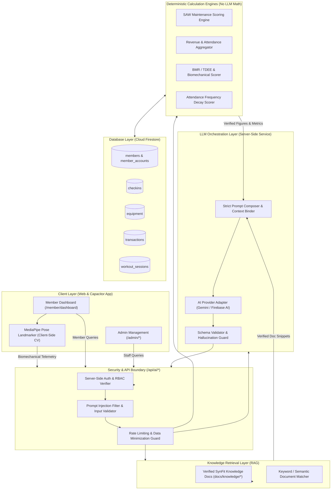

# SYNFIT AI — PART 1: SYSTEM AUDIT & AI FOUNDATION REPORT

**Document ID:** SYNFIT-AI-AUDIT-001  
**Project:** SynFit / Areta Sport Fitness  
**Date:** 2026-10-19  
**Status:** Complete (Audit & Safe Foundation Phase)  
**Author:** Senior Software Architect & AI Engineering Team  

---

## 1. Executive Summary

This report establishes the baseline technical audit, data asset mapping, security posture, and architectural design for integrating AI into the SynFit fitness management ecosystem.

The primary objective of **Part 1** is non-destructive discovery and the establishment of a zero-regression, zero-cost AI foundation. In accordance with strict implementation guidelines:
- No existing production data was fabricated.
- No existing application features, routing, or database structures were removed or modified.
- No external paid AI dependencies or vector databases were prematurely introduced.
- Existing computer vision capabilities (MediaPipe) and deterministic mathematical frameworks (SAW Decision Support System) were thoroughly audited and contextualized for future AI augmentation.

---

## 2. Verified Technology Stack

| Layer | Verified Technology | Version / Specification | Codebase Verification Source |
| :--- | :--- | :--- | :--- |
| **Frontend Framework** | Next.js (App Router) | `15.0.0` (React `19.0.0`, React-DOM `19.0.0`) | `package.json`, `src/app/layout.tsx` |
| **Language** | TypeScript | `^5.0.0` (Strict mode configured) | `tsconfig.json`, `package.json` |
| **Styling & Design System** | Tailwind CSS & Framer Motion | Tailwind `^3.4.1`, Framer Motion `^11.11.0`, Lucide React | `tailwind.config.ts`, `src/app/globals.css` |
| **State Management** | Zustand (Client-side persisted) | `^5.0.0` | `src/store/useAuthStore.ts`, `useUIStore.ts`, `useLanguageStore.ts` |
| **Mobile Runtime** | Capacitor (Android & iOS) | `^8.3.3` | `capacitor.config.ts`, `android/`, `ios/` |
| **Database** | Google Cloud Firestore (NoSQL) | Client SDK `^11.10.0`, Admin SDK `^13.9.0` | `src/lib/firebase.ts`, `src/lib/firebase-admin.ts`, `firestore.rules` |
| **Authentication** | Firebase Authentication + Firestore Session | Email/Password, WhatsApp-linked member credentials | `src/lib/firebase.ts`, `src/app/login/member/page.tsx`, `src/app/login-admin/page.tsx` |
| **Media & Storage** | Cloudinary CDN | Unsigned client preset + server API keys | `src/lib/cloudinary.ts` |
| **Computer Vision / ML** | MediaPipe Tasks Vision | `@mediapipe/tasks-vision` `^1.1.0` (Pose Landmarker) | `src/lib/exerciseAnalyzer/`, `src/components/AIFormCoach.tsx` |
| **Data Viz & Reporting** | Recharts, jsPDF, html2canvas | Recharts `^2.13.0`, jsPDF `^4.2.1` | `src/app/admin/reports/page.tsx`, `src/app/admin/spk/page.tsx` |
| **Messaging & Push** | Firebase Cloud Messaging (FCM) | `@firebase/messaging` | `src/lib/firebase.ts`, `src/hooks/useFcm.ts` |

---

## 3. Module & Database Inventory

### 3.1. Verified Firestore Collections

Every collection below has been verified against active code (`firestore.rules`, `src/lib/firebase.ts`, and active page queries):

| Collection Name | Primary Responsibility | Key Verified Fields | Read Access | Write Access | AI Readiness Status |
| :--- | :--- | :--- | :--- | :--- | :--- |
| `users` | Staff and administrative identity records | `uid`, `name`, `username`, `email`, `role` (`"Admin"`, `"Owner"`, `"Developer"`), `status`, `created_at` | Unauthenticated read (login lookup) | Authenticated staff (`request.auth != null`) | **Verified** — Ready for Admin/Owner RBAC gating |
| `members` | Master membership registry | `nama`, `nomor_whatsapp`, `alamat`, `membership_type` (`1 Bulan`, `3 Bulan`), `status`, `tanggal_daftar`, `tanggal_expired`, `qr_token`, `tinggi_badan`, `berat_badan`, `jenis_kelamin`, `umur`, `target_fitness` | Public `get` (single card), Restricted `list` | Authenticated staff (Admin) | **Verified** — Core ground truth for Member AI modules |
| `member_accounts` | Member web login credentials | `member_id` (ref), `nama`, `nomor_whatsapp`, `password` | Public read for login validation | Public create/update (reg/password reset), Admin delete | **Verified** — Auth verification layer |
| `registrations` | Signup & renewal approval queue | `nama`, `nomor_whatsapp`, `alamat`, `membership_type`, `amount`, `payment_method`, `bukti_pembayaran`, `status` (`Pending`, `Approved`), `is_renewal` | Public create/read | Authenticated staff (`request.auth != null`) | **Verified** — Pipeline input for Business & Churn AI |
| `checkins` | Contactless QR & GPS attendance logs | `member_id`, `member_name`, `qr_token`, `status`, `type` (`Member Check-in`, `Daily Visitor`), `scanned_at` | Public create/read | Authenticated staff delete | **Verified** — Critical source for Churn Prediction & Progress |
| `configs` | Gym operational settings | `id: 'gym'`, `latitude`, `longitude`, `radius`, `qris_image_url` | Public read | Authenticated staff write | **Verified** — Ground truth for Gym rules / FAQ |
| `chats` | Internal administrative chat room | `sender_id`, `sender_name`, `sender_role`, `content`, `image_url`, `created_at` | Authenticated staff | Authenticated staff | **Verified** — Internal context only |
| `member_chats` | Customer-to-desk direct support | `member_id`, `sender_id`, `sender_name`, `sender_role` (`ADMIN`, `MEMBER`), `content`, `created_at` | Public read/write | Public read/write | **Verified** — Target host channel for AI Assistant |
| `equipment` | Gym machines & weights inventory | `equipId`, `name`, `category`, `condition`, `age`, `kerusakan`, `pemakaian`, `umur`, `biaya`, `risiko`, `deskripsi` | Public read | Authenticated staff write | **Verified** — Ground truth for AI Maintenance Assistant |
| `transactions` | Financial revenue ledger | `member`, `type`, `amount`, `method`, `status`, `date`, `created_at` | Authenticated staff read/update | Public create, Admin read/update | **Verified** — Financial ground truth for AI Business Insights |
| `workout_sessions` | AI Form Coach biomechanical session logs | `member_id`, `exercise`, `total_reps`, `valid_reps`, `form_score`, `created_at` | Public read/create | Authenticated staff update/delete | **Verified** — Ground truth for Progress & Form AI |
| `notifications` | FCM push notification history | `member_id`, `title`, `body`, `is_read`, `created_at` | Public read/write | Public read/write | **Verified** — Outbound alert channel |

### 3.2. Application Module Audit

| Module Name | File Path(s) | Role & Authentication | AI Readiness Status | Current Implementation Notes |
| :--- | :--- | :--- | :--- | :--- |
| **Member Portal** | `src/app/member/dashboard/page.tsx` | Member Session (`localStorage: member_session`) | **Verified** | Multi-tab client dashboard (Home, Pass, Coach, Chat, Profile). Ready for AI integrations. |
| **AI Form Coach (Vision)** | `src/components/AIFormCoach.tsx`, `src/lib/exerciseAnalyzer/` | Member Session | **Verified** | MediaPipe client-side pose landmarking for Squat, Push-up, and Bicep curl. Local mathematical angle tracking. |
| **Attendance & Scanner** | `src/app/admin/scanner/page.tsx`, `src/components/QRScannerFAB.tsx` | Staff Auth / Camera | **Verified** | QR code scanning via `html5-qrcode`. Writes to `checkins` collection. |
| **Equipment & SPK** | `src/app/admin/spk/page.tsx`, `src/app/admin/equipment/page.tsx` | Staff Auth (`Admin`, `Owner`) | **Verified** | Deterministic SAW (Simple Additive Weighting) MCDM algorithm calculating priority scores based on 5 weighted criteria. |
| **Financial Reports** | `src/app/admin/reports/page.tsx`, `src/app/admin/transactions/page.tsx` | Staff Auth (`Admin`, `Owner`) | **Verified** | Aggregates daily/monthly revenue, exports CSV/PDF via jsPDF. |
| **Staff & User Management** | `src/app/admin/users/page.tsx`, `src/app/api/users/delete/route.ts` | Owner / Developer Only | **Verified** | Strict RBAC. Uses Firebase Auth Admin SDK on server. |

---

## 4. Existing Authentication and Role Analysis

### 4.1. Identity Architectures
The system uses a **dual-tiered authentication model**:

1. **Staff / Administrative Tier (`/login-admin`)**:
   - Backed by **Firebase Authentication** (`signInWithEmailAndPassword`).
   - Profile record stored in Firestore `users` collection mapped via `uid`.
   - Active roles verified in code:
     - `DEVELOPER`: Full access, including bypass permissions in `users/delete/route.ts`.
     - `OWNER`: Full access to user management, revenue auditing, settings, and staff chat.
     - `ADMIN`: Operational access (members, equipment, check-ins, reports, chat). Blocked from `/admin/users`.
   - Session preserved via Zustand `useAuthStore` with local persistence.

2. **Customer / Member Tier (`/login/member`, `/membership`)**:
   - Backed by **Firestore Document Validation** (`member_accounts` collection).
   - Login identity: Normalized WhatsApp phone number (`+62...`) + Member password.
   - Profile record linked to `members` collection via `member_id`.
   - Session preserved via `localStorage.getItem("member_session")`.
   - Role: `MEMBER`.

### 4.2. Security Boundaries for AI Integration
- **Client-Side Gating**: Must not be solely relied upon. An LLM API route must never trust client-supplied roles.
- **Server-Side Token Verification**: Staff AI routes must verify the Firebase ID Token (`Bearer <token>`) using `firebase-admin.ts` `verifyIdToken()`.
- **Member-Scoped AI Queries**: Member AI routes must enforce query filtering using the verified `member_id`. Members must never be able to prompt the AI to inspect other members' records.

---

## 5. Data-Source Map for Future AI Modules

| Planned AI Module | Required Data Inputs | Data Availability in System | Source of Truth / Calculation Rule |
| :--- | :--- | :--- | :--- |
| **1. AI Assistant (Member FAQ & Support)** | Gym opening hours, pricing, dress code, facility rules, membership terms | **Partially Available** (Some configs in `configs/gym`, terms on landing page; formal FAQ document not yet compiled) | Static verified knowledge base markdown documents. LLM must cite verified documents, not invent policies. |
| **2. Knowledge Base & RAG** | Official equipment manual, certified workout form guidelines, subscription contracts | **Not Available** (No documents repository exists in codebase yet) | Curated static knowledge markdown files under `docs/knowledge/` with versioning. |
| **3. AI Exercise Form Assistant** | Joint angles, body landmark coordinates, rep tempo, ROM | **Already Available** via `@mediapipe/tasks-vision` in `src/lib/exerciseAnalyzer/` | Deterministic mathematical calculations in `angleUtils.ts` and `formScorer.ts`. LLM only generates post-set verbal coaching insights. |
| **4. AI Workout Plan Generator** | Member profile (age, gender, weight, height, goal, available gym equipment) | **Partially Available** (Member biometrics in `members`, gym equipment list in `equipment`) | Equipment compatibility verified against active `equipment` collection. BMR/TDEE calculated deterministically via Mifflin-St Jeor equation. |
| **5. AI Progress Analyzer** | Historical attendance, workout session form scores, biometrics over time | **Partially Available** (`checkins` and `workout_sessions` exist; body weight change logs over time not yet collected) | Deterministic attendance frequency and average form score calculations. LLM provides qualitative milestone encouragement. |
| **6. AI Business Insight** | Monthly revenue, new member acquisition, attendance density, churn rate | **Already Available** (`transactions`, `registrations`, `checkins`, `members`) | Exact revenue and headcount sums calculated by deterministic code. LLM provides executive summaries and anomaly observations. |
| **7. AI Churn Prediction** | Days until expiry, check-in frequency decay, historical renewals | **Already Available** (`members.tanggal_expired`, `checkins`, `registrations.is_renewal`) | Deterministic decay score (% drop in 30-day visits vs previous 30 days) combined with predictive risk scoring. |
| **8. AI Maintenance Assistant** | Equipment condition scores, economic age, failure risk, SAW priority | **Already Available** (`equipment` collection with SAW criteria C1-C5 and weights) | Deterministic SAW (Simple Additive Weighting) algorithm in `src/app/admin/spk/page.tsx`. LLM generates contextual maintenance action plans based on calculated rank. |

---

## 6. Proposed AI Architecture

### Architectural Principles:
1. **Zero LLM Database Access**: The LLM never communicates directly with Firestore or receives unrestricted read permissions. Database queries are executed strictly by deterministic service functions.
2. **Zero LLM Arithmetic**: All currency totals, attendance counts, BMR/TDEE calculations, and SAW equipment priority scores are computed in TypeScript code before prompt construction.
3. **Local Computer Vision**: Heavy vision processing (pose estimation, joint angles) runs entirely client-side via MediaPipe. Only lightweight mathematical telemetry (scores, angles) is transmitted to the server.

---

## 7. Security and Privacy Requirements

| Requirement | Implementation Strategy |
| :--- | :--- |
| **Server-Side Authentication** | Every `/api/ai/*` route must extract and verify caller identity. Staff endpoints verify Firebase Auth Bearer tokens. Member endpoints verify session integrity against Firestore. |
| **Role-Based Authorization (RBAC)** | Administrative modules (Business Insights, Maintenance Assistant) are strictly restricted to `OWNER`, `DEVELOPER`, or `ADMIN`. Members attempting administrative endpoints receive HTTP 403 Forbidden. |
| **User Data Isolation** | Member AI queries are automatically scoped by `member_id`. Context prompts cannot include or search cross-member records. |
| **Prompt Injection Protection** | User inputs are sanitized. System prompts are structurally demarcated with clear separation between instructions and user-supplied data strings. |
| **Data Minimization** | Raw names, WhatsApp numbers, and payment receipts are stripped prior to external LLM dispatch. The LLM receives anonymized identifiers (e.g. `Member_Active_3M`). |
| **Camera & Video Privacy** | Video feeds from the AI Form Coach are processed entirely in browser memory. No video streams or camera frames are uploaded or stored on any server. |
| **API Key Protection** | AI Provider API keys (e.g. `GEMINI_API_KEY`) reside exclusively in server-side environment variables and are never prefixed with `NEXT_PUBLIC_`. |

---

## 8. Verified Codebase Changes (Foundation Established)

In accordance with Section 7 of the mandate, the following minimal, zero-dependency foundational contracts were created to prepare the application for Part 2:

1. [`src/lib/ai/types.ts`](file:///c:/Users/ThinkPad/.gemini/antigravity/scratch/areta-fitness/src/lib/ai/types.ts):
   - Strict TypeScript interfaces for all 8 planned AI modules.
   - Standardized request/response envelopes, deterministic metric interfaces, and role definitions.
2. [`src/lib/ai/errors.ts`](file:///c:/Users/ThinkPad/.gemini/antigravity/scratch/areta-fitness/src/lib/ai/errors.ts):
   - Centralized error taxonomy (`AIValidationError`, `AIAuthorizationError`, `AIRateLimitError`, `AIInjectionError`).
3. [`src/lib/ai/config.ts`](file:///c:/Users/ThinkPad/.gemini/antigravity/scratch/areta-fitness/src/lib/ai/config.ts):
   - Server-only configuration boundary ensuring API keys cannot leak to client bundles.

**Existing Application Files Modified:**
- None. All existing application files, routes, components, and configurations remain 100% untouched.

---

## 9. Testing & Validation Results

| Test / Check Executed | Command | Result | Notes |
| :--- | :--- | :--- | :--- |
| **TypeScript Static Analysis** | `npx tsc --noEmit` | **PASS (Exit code 0)** | Zero type errors across the entire codebase including new AI contracts. |
| **Endpoint Accessibility** | `Invoke-WebRequest` | **PASS (HTTP 200)** | Verified `/login/member/`, `/membership/?tab=register`, `/login-admin/`. |
| **Automated Unit Tests** | Search for test suites in `src/` | **NOT CONFIGURED** | No unit test runners (Jest/Vitest) currently exist in project dependencies. |
| **Linter Configuration** | `npm run lint` | **ACTION REQUIRED** | Prompts for interactive ESLint setup. Default Next.js linter config not committed. |

### Security Concerns Discovered During Audit:
1. `firestore.rules`:
   - Collection `/members` allows unauthenticated `update` for profile editing: `allow update: if true;`. This should be hardened in subsequent phases with proper session checks.
   - Collection `/checkins` allows `allow read, create, update: if true;`. Should be protected with token verification.
2. `users/delete/route.ts`: Contains a development bypass `if (process.env.NODE_ENV === "development") isAuthorized = true;`. Must never leak into production.

---

## 10. Prioritized Implementation Plan for Part 2

Upon approval of this audit, Part 2 should proceed in the following prioritized sequence:

1. **Phase 2.1 — Knowledge Base & AI Assistant Foundation**:
   - Establish verified markdown knowledge documents (`docs/knowledge/` covering pricing, opening hours, gym etiquette, and membership FAQ).
   - Implement server-side RAG retrieval service with strict document grounding.
2. **Phase 2.2 — AI Form Coach Intelligence Layer**:
   - Connect client-side MediaPipe telemetry from `AIFormCoach.tsx` to server-side biomechanical evaluation service.
   - Generate qualitative coaching feedback based on deterministic joint angle scores.
3. **Phase 2.3 — AI Workout Plan Generator**:
   - Create deterministic BMR/TDEE calculation utilities.
   - Link workout generator to verified gym `equipment` inventory so only available gym gear is recommended.
4. **Phase 2.4 — Administrative AI Insights & Predictive Churn**:
   - Implement deterministic attendance decay algorithm.
   - Build executive summary and churn risk dashboard for Owner/Admin.
