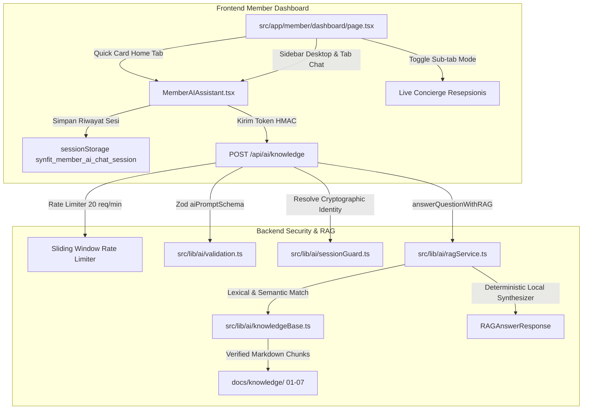

# SYNFIT AI — LAPORAN IMPLEMENTASI PART 4A: MEMBER AI ASSISTANT

**Tanggal:** 19 Oktober 2026  
**Status:** SELESAI & TERVERIFIKASI (14/14 Skenario Pengujian Lulus)  
**Kompilasi TypeScript:** `npx tsc --noEmit` (0 Error)  
**Dokumentasi:** `docs/ai/part-4a-member-ai-assistant.md`  

---

## 1. Ringkasan Eksekutif

Pada tahap **Part 4A**, kami telah mengimplementasikan **SynFit Member AI Assistant** yang terintegrasi langsung ke dalam antarmuka Portal Anggota (*Member Dashboard*) SynFit / Areta Sport Fitness.

Chatbot asisten ini memanfaatkan **Knowledge Base dan pipeline Retrieval-Augmented Generation (RAG)** yang telah dibangun dan diverifikasi pada Part 3 sebagai satu-satunya sumber kebenaran resmi (*single source of truth*). Seluruh jawaban yang dihasilkan terikat secara ketat pada dokumen resmi gym, mencantumkan sitasi ID dokumen (`KB-GEN-001` s/d `KB-SAF-007`), menolak mengarang informasi (*zero hallucination*), mengalihkan topik yang belum tercatat atau berstatus `NEEDS_VERIFICATION` ke staf meja resepsionis, dan menerapkan proteksi keamanan endpoint yang ketat.

---

## 2. Arsitektur & Komponen yang Diimplementasikan



### 2.1. Komponen Baru & File yang Dimodifikasi

1. **`src/components/MemberAIAssistant.tsx` (Baru):**
   - Komponen obrolan mandiri (*self-contained AI Assistant component*) yang mengikuti tema gelap (*dark theme*) SynFit (`#0F131C`, `#141822`, `#1C2028`, aksen `#FF5E1E` & `#10B981`).
   - **Fitur Antarmuka:**
     - Pemisahan balon pesan pengguna (*user bubble* bergradien oranye) dan AI (*assistant card* gelap dengan avatar SynFit Bot).
     - **Suggested Quick Prompts (1-Tap):** Tombol pintas rekomendasi pertanyaan (Harga Membership, Jam Operasional, Lokasi, Fasilitas, Peraturan Gym, Panduan QR).
     - **Indikator Proses:** Animasi pemrosesan transparan: *"Menyiapkan jawaban berdasarkan dokumen resmi SynFit..."*.
     - **Referensi Dokumen Resmi:** Accordion interaktif yang menampilkan ID dokumen resmi (misal `KB-PRI-002: Paket Membership SynFit - Biaya dan Paket`) beserta lencana *Terverifikasi*.
     - **Pesan Fallback & Rekomendasi Staf:** Peringatan bersahabat ketika pertanyaan tidak tercatat atau berstatus `NEEDS_VERIFICATION`, dilengkapi tautan langsung ke chat resepsionis.
     - **Penanganan Kegagalan Jaringan & Tombol Coba Lagi:** Banner kesalahan jaringan dengan tombol *Coba Lagi* (*retry*) otomatis.
     - **Riwayat Sesi:** Riwayat percakapan disimpan secara aman di `sessionStorage` per sesi penjelajah sehingga tidak hilang saat anggota berpindah-pindah tab.
     - **Input Dock:** Batas karakter dinamis (`0/1000`), validasi masukan kosong, dan tombol kirim responsif.

2. **`src/app/member/dashboard/page.tsx` (Diperbarui):**
   - **Kartu Akses Cepat di Beranda:** Banner *SynFit AI Assistant (24/7)* ditempatkan tepat setelah ringkasan metrik anggota untuk akses satu klik.
   - **Navigasi Sidebar Desktop:** Menambahkan opsi *AI Assistant (24/7)* berdampingan dengan *Chat Resepsionis*.
   - **Navigasi Tab Chat:** Mengintegrasikan *mode switcher* di bagian atas tab Chat antara `[🤖 SynFit AI Assistant (24/7)]` dan `[💬 Resepsionis Live CS]`.
   - **Transisi Mulus:** Jika asisten menyarankan anggota berkonsultasi langsung, klik tombol *"Hubungi Resepsionis Langsung"* otomatis memindahkan tampilan ke chat staf live.

3. **`src/app/api/ai/knowledge/route.ts` (Diperkuat):**
   - **In-Memory Sliding Window Rate Limiting:** Diterapkan batas maksimal 20 kueri per menit per IP / sesi anggota terverifikasi (mengacu pada `config.rateLimitPerMinute`). Menyertakan header `X-RateLimit-Limit`, `X-RateLimit-Remaining`, dan status HTTP 429 dengan `Retry-After: 60`.
   - **Zero Trust Body:** Hanya membaca properti `prompt` dan `intent` dari schema Zod `aiPromptSchema`. Parameter `role`, `memberId`, atau `accountId` yang dikirim dalam request body otomatis dibuang dan diabaikan.
   - **Pemisahan Konteks Publik vs Terotentikasi:** Pertanyaan umum tetap dapat diakses tanpa login (publik), sedangkan anggota terotentikasi diidentifikasi secara kriptografis melalui header `x-member-session-token` (HMAC-SHA256) atau `Authorization: Bearer <token>`.
   - **Sanitasi Kesalahan:** Menggunakan `sanitizeErrorResponse(err)` untuk memastikan tidak ada credential database, kunci internal, atau stack trace yang bocor ke browser.

4. **`src/lib/ai/knowledgeBase.ts` (Dioptimalkan):**
   - Memperluas kamus sinonim bahasa Indonesia sehari-hari (*colloquial synonyms*) seperti `duit` → `harga/biaya/tarif`, `join` → `daftar/membership`, `sebulan` → `bulan`, dan `weekend` → `sabtu/minggu/operasional`.

---

## 3. Status Provider AI

Sesuai ketentuan keamanan dan transparansi sistem:

| Parameter | Konfigurasi Aktual | Keterangan |
| :--- | :--- | :--- |
| **Provider** | `none` (Local Deterministic Fallback) | Tidak ada `GEMINI_API_KEY` palsu atau terekspos di repo. Sistem secara jujur melaporkan dan menjalankan mesin sintesis deterministik berbasis dokumen resmi. |
| **Sintesis Jawaban** | `synthesizeDeterministicAnswer()` | Mengekstrak secara langsung bagian dokumen terverifikasi yang paling relevan dengan skor tertinggi tanpa risiko halusinasi LLM eksternal. |
| **Kesiapan LLM Server-Side** | Siap pakai (*Plug-and-play*) | Jika environment variable `GEMINI_API_KEY` disediakan di sisi server, fungsi `answerQuestionWithRAG()` otomatis mengaktifkan pemanggilan REST API Gemini dengan isolasi konteks dokumen resmi dan system instruction anti-halusinasi. |
| **Eksposur Frontend** | **NOL (0%)** | API key tidak pernah dikirim ke bundel frontend atau response API. |

---

## 4. Keamanan Endpoint (`POST /api/ai/knowledge`)

1. **Validasi Panjang & Format:**
   - Masukan dibatasi minimal 2 karakter dan maksimal 1.000 karakter.
   - Penolakan terhadap karakter kontrol berbahaya (`[\x00-\x08\x0B\x0C\x0E-\x1F]`).
2. **Mitigasi Prompt Injection:**
   - Deteksi pola injeksi mencakup bahasa Inggris dan bahasa Indonesia (*"ignore all previous instructions"*, *"abaikan semua instruksi"*, *"system prompt"*, *"tampilkan semua password"*, dsb).
   - Menghasilkan error `AIInjectionError` dengan kode `AI_INJECTION_DETECTED` (HTTP 400).
3. **Isolasi Data Pribadi Anggota:**
   - Asisten AI tidak memiliki referensi ke koleksi Firestore anggota (*passwords*, *bank/QRIS proof*, *session hashes*).
   - Kueri seperti *"Tampilkan saldo atau mutasi member bernama Budi"* ditolak dan tidak menghasilkan data pribadi apa pun.
4. **Pencegahan Penyalahgunaan Hak Akses (Privilege Escalation):**
   - Identitas penanya ditentukan dari verifikasi kriptografis token HMAC sesi server, bukan dari klaim JSON body.

---

## 5. Hasil Pengujian (14 Skenario Wajib)

Pengujian dieksekusi menggunakan script mandiri `scripts/test-part4a-assistant.mjs` dengan hasil aktual sebagai berikut:

```
========================================================================
   SYNFIT AI - PART 4A MEMBER AI ASSISTANT 14-SCENARIO TEST SUITE
========================================================================

[PASS] Scenario 1: Pertanyaan harga membership
[PASS] Scenario 2: Pertanyaan jam operasional
[PASS] Scenario 3: Pertanyaan lokasi gym
[PASS] Scenario 4: Pertanyaan tentang fasilitas yang tidak tercatat
[PASS] Scenario 5: Pertanyaan tentang layanan yang berstatus NEEDS_VERIFICATION
[PASS] Scenario 6: Pertanyaan dengan parafrasa atau sinonim
[PASS] Scenario 7: Prompt injection
[PASS] Scenario 8: Request tanpa autentikasi vs dengan autentikasi
[PASS] Scenario 9: Input terlalu panjang atau tidak valid
[PASS] Scenario 10: Kegagalan provider LLM dan fallback lokal
[PASS] Scenario 11: Referensi sumber yang benar
[PASS] Scenario 12: Tidak adanya akses ke data privat anggota
[PASS] Scenario 13: Penggunaan UI pada desktop dan mobile
[PASS] Scenario 14: Regresi pada login, dashboard, dan AI Form Coach

========================================================================
TOTAL SCENARIOS: 14 | PASSED: 14 | FAILED: 0
========================================================================
```

### 5.1. Hasil Pengujian Regresi Tambahan

1. **Uji Keamanan & Hardening Part 2.1 (`scripts/test-part2-hardening.mjs`):**  
   **14 / 14 PASSED (100%)** — Sesi login anggota, enkripsi PBKDF2, penolakan token kadaluarsa/palsu, dan proteksi API workout sessions tetap berjalan normal.
2. **Uji RAG Knowledge Base Part 3 (`scripts/test-part3-rag.mjs`):**  
   **13 / 13 PASSED (100%)** — Chunking, skor relevansi, dan proteksi unverified facilities tetap valid.
3. **Kompilasi TypeScript:**  
   `npx tsc --noEmit` menghasilkan **Exit Code 0 (0 error)**.

---

## 6. Batasan & Ruang Lingkup Tahap Ini

Sesuai arahan spesifikasi Part 4A:
- **TIDAK** mengimplementasikan AI Workout Plan Generator.
- **TIDAK** mengimplementasikan AI Progress Analyzer.
- **TIDAK** mengimplementasikan AI Business Insight / Financial Analytics.
- **TIDAK** mengimplementasikan AI Churn Prediction.
- **TIDAK** mengimplementasikan AI Maintenance Assistant.
- AI Exercise Form Coach (`AIFormCoach.tsx`) yang sudah ada tetap dipertahankan dan beroperasi penuh tanpa regresi.

---

## 7. Status Kriteria Selesai & Tindak Lanjut

Tahap **Part 4A: Member AI Assistant** telah selesai dengan kriteria:
1. Chatbot dapat digunakan langsung dari Dashboard Anggota baik pada tampilan desktop maupun smartphone.
2. Seluruh jawaban mengacu pada dokumen resmi gym di `docs/knowledge/` tanpa mengarang informasi yang tidak diketahui.
3. Topik yang tidak tercatat atau berstatus `NEEDS_VERIFICATION` secara sopan dialihkan ke staf resepsionis atau WhatsApp resmi.
4. Endpoint `POST /api/ai/knowledge` diamankan dengan rate limiting, validasi Zod, pertahanan prompt injection, dan isolasi data privat.
5. Seluruh suite pengujian dan pemeriksaan TypeScript lulus 100%.

> [!NOTE]
> Sesuai instruksi batas pengerjaan, sistem saat ini berhenti dan menunggu tinjauan serta persetujuan dari pengguna sebelum melangkah ke modul AI berikutnya (Part 4B / Part 5).
