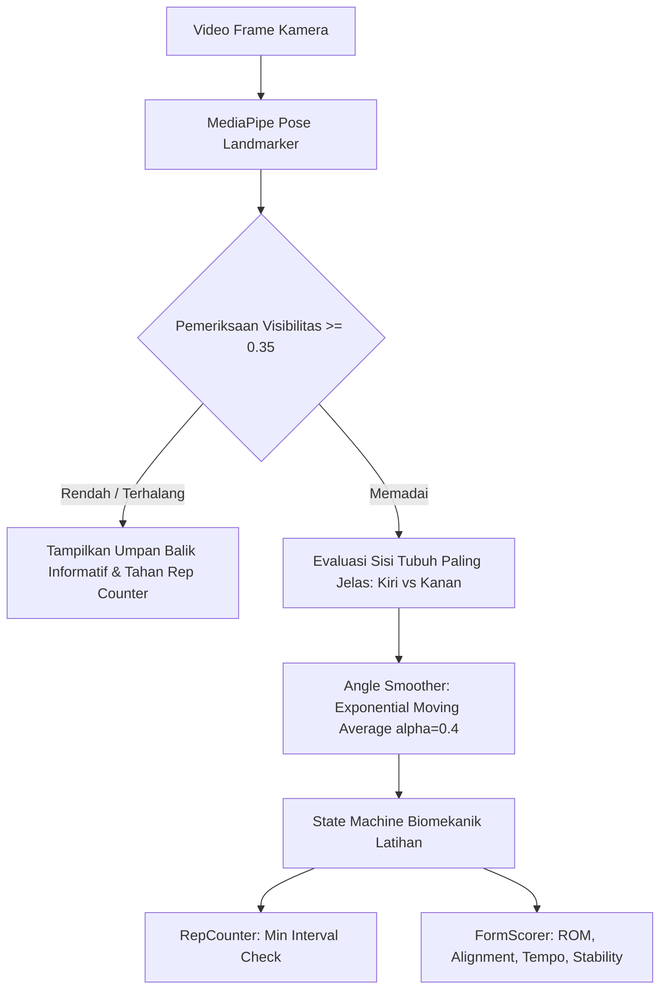

# SYNFIT AI — PART 4B: EXERCISE FORM ASSISTANT HARDENING REPORT

## 1. Executive Summary

Laporan ini mendokumentasikan hasil audit, pengerasan (*hardening*), dan pengujian komprehensif terhadap fitur **AI Exercise Form Assistant** pada platform SynFit (Areta Sport Fitness). 

Sesuai instruksi dan batasan ruang lingkup:
- Arsitektur pemrosesan MediaPipe Pose Landmarker tetap berjalan **100% di browser (client-side)** tanpa mengirim video, gambar, atau stream piksel ke server.
- Pipeline MediaPipe yang sudah ada dipertahankan dan diperkuat dengan pemeriksaan visibilitas landmark minimum (`minVisibility = 0.35`).
- Seluruh perhitungan repetisi, sudut sendi, fase biomekanik, dan penilaian postur dilakukan secara **deterministik matematis**, bukan diestimasi atau dihalusinasi oleh LLM.
- Umpan balik form difokuskan pada metrik sudut terukur secara objektif, tanpa klaim kelayakan medis atau jaminan bebas cedera berdasarkan estimasi 2D.
- Penyimpanan ringkasan sesi diamankan secara penuh melalui endpoint server terverifikasi (`POST /api/workout-sessions`) dengan skema Zod ketat, perlindungan pemalsuan `member_id`, serta **penghapusan total fallback Client SDK Firestore write**.

---

## 2. Audit Kode & Arsitektur Implementasi

### 2.1 Komponen & File Inti
| Komponen / Berkas | Fungsi Utama | Status Hardening |
|---|---|---|
| `src/components/AIFormCoach.tsx` | UI interaktif, lifecycle webcam, rendering canvas overlay, integrasi MediaPipe, dan pelaporan ringkasan latihan. | **Dihardening**: Penghapusan direct Firestore Client SDK fallback, penanganan eksplisit `NotAllowedError`/`NotFoundError`, disclaimer keamanan biomekanik 2D, dan isolasi privasi video. |
| `src/lib/exerciseAnalyzer/` | Engine kalkulasi deterministik: `SquatAnalyzer`, `PushUpAnalyzer`, `BicepCurlAnalyzer`, `RepCounter`, `FormScorer`, `AngleSmoother`. | **Dihardening**: Validasi `MIN_VISIBILITY = 0.35`, pencegahan double counting dengan lock temporal, deteksi sisi tubuh optimal secara dinamis. |
| `src/app/api/workout-sessions/route.ts` | Endpoint server untuk menyimpan ringkasan sesi latihan. | **Dihardening**: Verifikasi identitas via `sessionGuard`, penolakan pemalsuan `member_id`, validasi Zod ketat, sanitasi field tanpa data media. |
| `src/lib/ai/validation.ts` | Skema Zod untuk validasi input numerik dan payload telemetri. | **Dihardening**: Ditambahkan `workoutSessionPayloadSchema` dan `workoutExerciseItemSchema` dengan batasan numerik ketat (0–1440 menit, 0–5000 repetisi, 0–100 form score). |
| `src/lib/ai/sessionGuard.ts` | Gatekeeper sesi anggota berbasis HMAC cryptographically signed token dan Firebase Admin SDK. | Terintegrasi penuh tanpa mengizinkan bypass header tidak terpercaya. |

### 2.2 Gerakan yang Didukung & Landmark MediaPipe

Sistem mendukung 3 gerakan fungsional utama dengan MediaPipe Pose (33 landmark 3D normalized):



1. **Squat**:
   - **Landmark yang Digunakan**: Hip (`left: 23, right: 24`), Knee (`left: 25, right: 26`), Ankle (`left: 27, right: 28`), Shoulder (`left: 11, right: 12`).
   - **Metrik Terukur**:
     - Sudut Lutut (*Knee Flexion*): Sudut antara Hip, Knee, dan Ankle.
     - Inklinasi Torso (*Torso Angle*): Sudut kemiringan bahu terhadap garis vertikal sumbu tubuh.
     - Penyelarasan Lutut (*Knee Tracking*): Selisih posisi horizontal lutut terhadap ankle.
   - **Fase Gerakan**: `STANDING` ($\ge 155^\circ$) $\rightarrow$ `DESCENDING` ($< 145^\circ$) $\rightarrow$ `BOTTOM` ($\le 110^\circ$, optimal $\le 95^\circ$) $\rightarrow$ `ASCENDING` ($> 120^\circ$) $\rightarrow$ `STANDING` ($\ge 155^\circ$).
   - **Aturan Repetisi**: Repetisi dihitung hanya jika pengguna mencapai fase `BOTTOM` kemudian kembali ke ekstensi penuh `STANDING` dengan interval waktu antarrepetisi minimal 1.200 ms.

2. **Push-Up**:
   - **Landmark yang Digunakan**: Shoulder (`left: 11, right: 12`), Elbow (`left: 13, right: 14`), Wrist (`left: 15, right: 16`), Hip (`left: 23, right: 24`), Ankle (`left: 27, right: 28`).
   - **Metrik Terukur**:
     - Sudut Siku (*Elbow Flexion*): Sudut antara Shoulder, Elbow, dan Wrist.
     - Kelurusan Tulang Belakang (*Body Alignment*): Sudut antara Shoulder, Hip, dan Ankle (ambang batas lurus $\ge 150^\circ$).
   - **Fase Gerakan**: `UP` ($\ge 155^\circ$) $\rightarrow$ `DOWN` ($< 140^\circ$, kedalaman dada $\le 90^\circ$) $\rightarrow$ `UP` ($\ge 155^\circ$).
   - **Aturan Repetisi**: Repetisi dihitung saat kembali ke posisi `UP` setelah menyentuh kedalaman siku $\le 105^\circ$ dengan interval waktu minimal 1.100 ms.

3. **Bicep Curl**:
   - **Landmark yang Digunakan**: Shoulder (`left: 11, right: 12`), Elbow (`left: 13, right: 14`), Wrist (`left: 15, right: 16`).
   - **Metrik Terukur**:
     - Sudut Siku: Sudut antara Shoulder, Elbow, dan Wrist.
     - Stabilitas Bahu / Drift Siku: Pergeseran horizontal siku terhadap bahu ($\le 0.12$ lebar frame ternormalisasi).
   - **Fase Gerakan**: `EXTENDED` ($\ge 145^\circ$) $\rightarrow$ `CURLING` ($< 135^\circ$) $\rightarrow$ `CONTRACTED` ($\le 70^\circ$, optimal $\le 55^\circ$) $\rightarrow$ `EXTENDED` ($\ge 145^\circ$).
   - **Aturan Repetisi**: Repetisi dihitung saat lengan kembali ke ekstensi penuh setelah puncak kontraksi tercapai, dengan interval waktu minimal 1.000 ms.

---

## 3. Deteksi Pose & Keamanan Kamera (Privacy & Safety)

1. **Client-Side Only**:
   - Semua pemrosesan MediaPipe Pose dilakukan secara lokal pada peramban web pengguna menggunakan WebAssembly dan WebGL/GPU (dengan fallback ke CPU jika WebGL tidak tersedia).
   - Tidak ada frame video, stream kanvas, atau file media yang dikirimkan ke server API mana pun.
2. **Lifecycle Kamera**:
   - Kamera dihentikan secara bersih (`mediaStreamRef.current.getTracks().forEach(track => track.stop())`) ketika:
     - Pengguna menekan tombol "Akhiri Sesi" atau tombol keluar.
     - Komponen dilepas (*unmount*) melalui pembersihan `useEffect`.
     - Pengguna berpindah tab atau menggunakan navigasi browser *history popstate*.
   - Tidak ada rekaman audio (`audio: false`).
3. **Penanganan Error Izin & Ketersediaan**:
   - `NotAllowedError` / `PermissionDeniedError`: Menampilkan petunjuk eksplisit untuk mengaktifkan izin kamera depan pada peramban.
   - `NotFoundError` / `DevicesNotFoundError`: Menampilkan pesan informatif bahwa perangkat tidak memiliki sensor kamera yang kompatibel.
   - Kegagalan model MediaPipe CDN: Menampilkan pesan peringatan koneksi jaringan dan menyediakan mekanisme coba lagi tanpa merusak UI.
4. **Validasi Landmark & Penolakan Oklusi**:
   - Jika landmark sendi utama memiliki `visibility < 0.35`, sistem membatalkan pembaruan repetisi dan memberikan pesan bimbingan:
     > *"Kualitas landmark rendah. Pastikan tubuh terlihat penuh di dalam frame kamera."*
   - Hal ini mencegah repetisi "hantu" (*ghost reps*) saat pengguna berada sebagian di luar jangkauan pandang kamera.

---

## 4. Integritas Metrik & Umpan Balik Form

### 4.1 Umpan Balik Berbasis Sudut Nyata
Seluruh umpan balik dihasilkan secara deterministik:
- **Squat**:
  - `lowestKneeAngle <= 95°`: *"Kedalaman squat optimal (sudut lutut <= 95°)."*
  - `lowestKneeAngle <= 110°`: *"Kedalaman squat cukup baik."*
  - `lowestKneeAngle > 115°`: *"Squat terlalu dangkal. Turunkan pinggul lebih rendah."*
  - `torsoIncline > 50°`: *"Jaga posisi punggung tetap tegak."*
  - `tempo < 500ms`: *"Gerakan turun terlalu cepat. Kontrol tempo."*
- **Push-Up**:
  - `lowestElbowAngle <= 90°`: *"Kedalaman push up optimal (sudut siku <= 90°)."*
  - `lowestElbowAngle <= 105°`: *"Kedalaman push up cukup baik."*
  - `bodyAngle < 150°`: *"Jaga pinggul tetap sejajar, hindari melengkung."*
- **Bicep Curl**:
  - `lowestElbowAngle <= 55°`: *"Kontraksi fleksi siku optimal (sudut siku <= 55°)."*
  - `horizontalDrift > 0.12`: *"Jaga siku tetap dekat dengan tubuh."*

### 4.2 Batasan Klaim Medis & Non-Halusinasi
- Sistem **tidak** mengklaim bahwa form pengguna "100% sempurna", "bebas risiko cedera", atau "aman secara medis".
- Komponen `AIFormCoach` menampilkan disclaimer eksplisit:
  > *"Deteksi form menggunakan computer vision 2D sebagai panduan latihan umum dan bukan pengganti instruksi profesional atau evaluasi medis."*
- Tidak ada kalori yang diestimasi tanpa rumus tervalidasi sensor metabolik (metrik difokuskan murni pada repetisi, durasi, dan skor form berbasis sudut sendi).

---

## 5. Keamanan Penyimpanan Sesi Latihan (`POST /api/workout-sessions`)

### 5.1 Pertahanan Terhadap Pemalsuan Identitas (Spoofing Defense)
Endpoint `/api/workout-sessions` mengintegrasikan `sessionGuard`:
- Identitas pemanggil diverifikasi dari token sesi kriptografis (`x-member-session-token` atau cookie terverifikasi).
- Jika penelepon berkedudukan sebagai `MEMBER`, server **secara paksa menimpa** nilai `member_id` dengan `context.memberId` yang sah dari token sesi server:
  ```ts
  if (context.role === "MEMBER") {
    effectiveMemberId = context.memberId!;
  }
  ```
- Nilai `member_id` apa pun yang dipalsukan di dalam JSON body diabaikan secara mutlak.

### 5.2 Validasi Skema Zod Ketat
Payload diperiksa menggunakan `workoutSessionPayloadSchema`:
- `duration_minutes`: Integer, $0 \le n \le 1440$ (maksimal 24 jam).
- `total_reps`: Integer, $0 \le n \le 5000$.
- `average_form_score`: Number, $0 \le n \le 100$.
- `exercise_count`, `completed_sets`, `incomplete_sets`: Integer non-negatif.
- Field gambar atau video dilarang dan tidak didefinisikan dalam skema.

### 5.3 Eliminasi Fallback Client SDK Firestore
Pada implementasi terdahulu, komponen UI memiliki fallback langsung:
```ts
// DIHAPUS TOTAL KARENA TIDAK AMAN:
// await addDoc(collection(db, "workout_sessions"), payload);
```
Fallback ini telah dihapus. Komponen UI kini hanya mengirim data ke endpoint API server internal `/api/workout-sessions`. Jika otentikasi server gagal atau token kedaluwarsa, sesi tidak ditulis ke Firestore dan UI menampilkan status kegagalan otentikasi kepada pengguna.

---

## 6. Hasil Pengujian Komprehensif (10 Skenario)

Uji coba otomatis dijalankan via script `scripts/test-part4b-coach.mjs` menggunakan data pose sintetis terukur:

```
========================================================================
   SYNFIT AI - PART 4B EXERCISE FORM ASSISTANT HARDENING TEST SUITE
========================================================================

[PASS] Scenario 1: Squat, push-up, dan bicep curl: Siklus Fase & Rep Counter
[PASS] Scenario 2: Pose tidak terdeteksi atau landmark tidak memadai
[PASS] Scenario 3: Penghitungan repetisi ganda (Anti-Double Counting)
[PASS] Scenario 4: Penggantian gerakan saat sesi berjalan
[PASS] Scenario 5: Kamera ditolak atau tidak tersedia
[PASS] Scenario 6: Penghentian kamera setelah sesi selesai
[PASS] Scenario 7: Request penyimpanan tanpa autentikasi (Server Security)
[PASS] Scenario 8: Pemalsuan member_id (Server enforces verified session identity)
[PASS] Scenario 9: Input metrik tidak valid (Zod validation rejections)
[PASS] Scenario 10: Regresi pada login, dashboard, dan chatbot

========================================================================
TOTAL SCENARIOS: 10 | PASSED: 10 | FAILED: 0
========================================================================
```

### 6.1 Rincian Evaluasi Tiap Skenario
1. **Siklus Fase & Rep Counter**: Memverifikasi state machine untuk squat (Standing $\rightarrow$ Descending $\rightarrow$ Bottom $\rightarrow$ Ascending $\rightarrow$ Standing), push-up (Up $\rightarrow$ Down $\rightarrow$ Up), dan bicep curl (Extended $\rightarrow$ Curling $\rightarrow$ Contracted $\rightarrow$ Extended). Seluruh repetisi dihitung tepat 1 repetisi per siklus valid.
2. **Pose Hilang / Landmark Rendah**: Memasukkan null landmarks dan landmark dengan visibilitas 0.1. Engine tidak menambah repetisi dan menerbitkan umpan balik bimbingan penataan kamera.
3. **Anti-Double Counting**: Membanjiri 5 frame standing beruntun dalam interval 50 ms setelah repetisi selesai. Rep counter tetap stabil pada nilai 1.
4. **Penggantian Gerakan Dinamis**: Penggantian dari squat ke bicep curl me-reset analyzer, memulai fase awal `EXTENDED`, dan mengatur repetisi awal gerakan baru ke 0 tanpa *side-effects*.
5. **Kamera Ditolak / Tidak Ditemukan**: Penanganan `NotAllowedError` dan `NotFoundError` diverifikasi menghasilkan pesan pengguna yang deskriptif dan ramah.
6. **Pembersihan Kamera**: Pemanggilan `track.stop()` diverifikasi pada unmount dan penghentian sesi. Kode dibersihkan dari pemanggilan `addDoc` client Firestore.
7. **Penyimpanan Tanpa Autentikasi**: Endpoint `/api/workout-sessions` mengembalikan status `HTTP 401 Unauthorized` dengan pesan kesalahan terstandarisasi.
8. **Pertahanan Pemalsuan `member_id`**: Upaya mengirim `member_id: "victim-member-999"` oleh member yang diautentikasi sebagai `legit-member-001` secara ketat digantikan oleh ID terverifikasi di server.
9. **Penolakan Validasi Zod**: Input repetisi negatif (-25), repetisi absurd (99.999), durasi negatif (-10), dan skor form di atas 100 ditolak dengan error `HTTP 400 Bad Request`.
10. **Regresi Fungsional**: Integritas file route login anggota, dashboard anggota, AI Knowledge RAG, dan komponen chatbot terkonfirmasi utuh.

### 6.2 Verifikasi Regresi Part 4A & Type Check
- **Part 4A Member Assistant Suite (`scripts/test-part4a-assistant.mjs`)**: 14/14 PASSED (100% green).
- **TypeScript Compilation (`npx tsc --noEmit`)**: 0 error, 0 warning.

---

## 7. Batasan Deteksi & Catatan Teknis (Detection Constraints)

Meskipun sistem telah diperkeras, terdapat batasan teknis inheren pada estimasi pose 2D berbasis peramban:

1. **Perspektif 2D Monokuler**:
   - Pengukuran sudut sendi dihitung dari koordinat proyeksi bidang kamera ($x, y$). Jika pengguna berdiri dengan sudut diagonal atau miring relatif terhadap lensa (bukan tegak lurus samping/depan), proyeksi geometris dapat terdistorsi (*foreshortening*).
2. **Oklusi Ekstremitas**:
   - Jika satu tangan atau kaki berada di belakang torso dari sudut pandang kamera, landmark estimasi MediaPipe dapat berfluktuasi. Algoritma telah memitigasi ini dengan memilih sisi tubuh yang memiliki visibilitas kumulatif tertinggi (`leftVis >= rightVis ? left : right`).
3. **Pencahayaan & Pakaian**:
   - Ruangan dengan pencahayaan latar (*backlighting*) ekstrem atau pakaian yang sangat longgar dapat mengurangi ketajaman deteksi kontur sendi MediaPipe di bawah ambang `0.35`.

---

## 8. Status Akhir & Rekomendasi Selanjutnya

Hardening Part 4B telah **selesai sepenuhnya** dan telah terverifikasi secara empiris. Tidak ada modul AI lanjutan (Workout Plan Generator, Progress Analyzer, dsb.) yang diaktifkan dalam tahap ini sesuai petunjuk.

Pengembangan dihentikan pada titik ini untuk menunggu peninjauan dan persetujuan pengguna sebelum melangkah ke Part 5.
