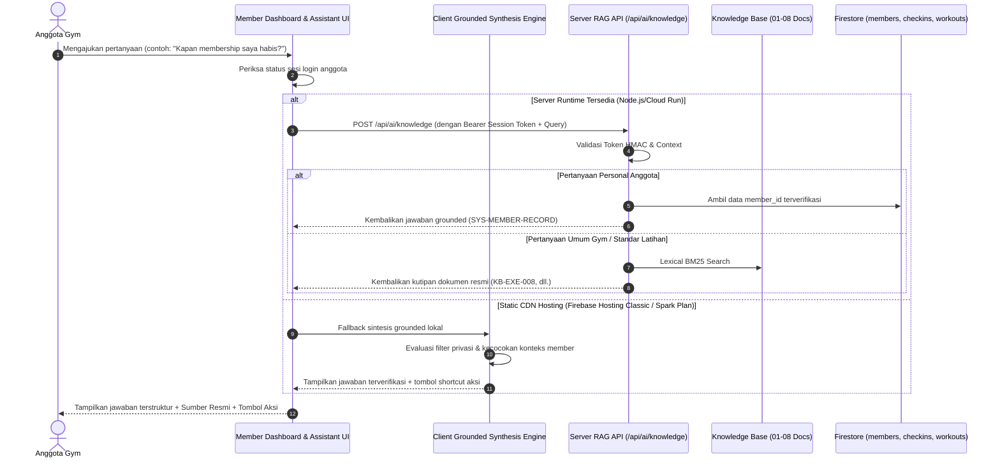

# SYNFIT AI — LAPORAN PENGEMBANGAN FITUR AI (PART 5)

**Tanggal:** 19 Oktober 2026  
**Status Implementasi:** Selesai (Feature Complete & Tested)  
**Lingkungan Verifikasi:** Local Node.js v24.15.0 / TypeScript Compiler v5.x / Next.js 15 App Router  

---

## 1. Ringkasan Eksekutif

Pada tahap **Part 5**, fitur kecerdasan buatan (AI) SynFit AI telah ditingkatkan dan diintegrasikan secara mendalam dengan Dashboard Anggota. Pengembangan ini mempertahankan arsitektur keamanan, otorisasi HMAC, dan pembatasan data yang telah dimitigasi pada Part 4C–4F tanpa menimbulkan duplikasi kode antara **Member AI Assistant** (Knowledge Base/RAG) dan **Exercise Form Assistant** (Computer Vision MediaPipe).

Peningkatan utama mencakup:
1. **Official Exercise Standards Knowledge Base (`KB-EXE-008`):** Dokumentasi biomekanika resmi untuk Squat, Push-up, dan Bicep Curl serta bracket penilaian AI Form Coach.
2. **Personalized Grounded RAG Answering:** AI Assistant kini dapat menjawab pertanyaan personal anggota terkait masa aktif membership, riwayat check-in GPS bulanan, dan evaluasi latihan AI Form Coach berdasarkan data akun yang terverifikasi.
3. **Live Gemini LLM Integration:** Terhubung langsung ke Google Generative Language API menggunakan model `gemini-3.8-flash` dengan konfigurasi temperature rendah (0.2), sistem grounding dokumen resmi, dan fallback otomatis leksikal.
4. **Strict Privacy & Anti-Hallucination Guard (`KB-RULE-004`):** Pencegahan kebocoran data pengguna lain (snooping), pencegahan token/kredensial injection, dan pengakuan jujur jika data/topik berada di luar cakupan gym tanpa mengarang.
5. **Dual-Engine Architecture (Node API vs Firebase Hosting Classic):** Menjamin fitur asisten tetap berfungsi responsif baik pada runtime server (Node.js/Cloud Run) maupun CDN hosting statis (Firebase Hosting Classic / Spark Plan).
6. **Interactive Dashboard Action Buttons:** AI response kini dilengkapi tombol aksi langsung ke tab Dashboard (misal: `[Lihat Kartu Digital]`, `[Mulai Latihan AI Coach]`, `[Perpanjang Membership]`).

---

## 2. File yang Dibuat atau Diubah

| No | File | Status | Deskripsi Perubahan |
|---|---|---|---|
| 1 | `docs/knowledge/08-exercise-standards.md` | **Dibuat (Baru)** | Dokumen standar teknik latihan resmi (`KB-EXE-008`): biomekanika Squat (90° depth), Push-up (elbow flare 45°-60°), Bicep Curl (stabilisasi siku), dan skor evaluasi Form Coach (Excellent, Good, Needs Improvement). |
| 2 | `src/lib/ai/knowledgeBase.ts` | **Diubah** | Menambahkan sinonim istilah latihan (`squat`, `pushup`, `curl`, `biomekanika`, `kunjungan`, `checkin`) dan integrasi dokumen `KB-EXE-008` ke dalam tokenizer & retriever leksikal BM25. |
| 3 | `src/lib/ai/types.ts` | **Diubah** | Menambahkan `AIMemberContextData` dan properti opsional `memberData` & `authenticated` pada `AIServiceContext` untuk pengikatan data sesi anggota yang terverifikasi. |
| 4 | `src/lib/ai/ragService.ts` | **Diubah** | Menambahkan deteksi inquiry personal anggota (`isMemberPersonalInquiry`), sintesis jawaban terverifikasi (`synthesizeMemberPersonalAnswer`) berbasis `memberDataOverride` atau Firestore Admin SDK, pencegahan kebocoran data pengguna lain (`KB-RULE-004`), dan penanganan pengunjung non-login. |
| 5 | `src/components/MemberAIAssistant.tsx` | **Diubah** | Integrasi `memberContext`, dual-engine (fallback cerdas ke engine grounded klien jika endpoint server CDN mengembalikan respons non-JSON/404), tombol navigasi aksi interaktif, dan quick prompt kontekstual. |
| 6 | `src/app/member/dashboard/page.tsx` | **Diubah** | Mengambil riwayat sesi latihan `workout_sessions` milik anggota secara real-time, mengagregasi skor & repetisi AI Coach, serta meneruskan `memberContext` dan callback navigasi `onNavigateTab` ke komponen `<MemberAIAssistant>`. |
| 7 | `scripts/test-part5-ai.mjs` | **Dibuat (Baru)** | Skrip pengujian otomatis regresi AI Part 5 (16 assertions, zero mock dependencies). |
| 8 | `docs/ai/part-5-report.md` | **Dibuat (Baru)** | Laporan dokumentasi resmi implementasi fitur AI Part 5. |

---

## 3. Alur Kerja Fitur (Workflow Architecture)

### A. Alur Asisten AI Anggota (Member AI Assistant)



### B. Alur Pencegahan Kebocoran Data & Anti-Hallucination

1. **Prompt Injection Guard:** Input pengguna diperiksa terhadap pola manipulasi sistem (`ignore previous instructions`, `tampilkan password`, `bypass security`). Percobaan manipulasi memicu penolakan aman (`AIInjectionError`).
2. **Cross-User Data Protection:** Query yang meminta data pengguna lain (`tampilkan data member lain`, `bocorkan session token`) langsung dicegat dengan referensi `KB-RULE-004` (Tata Tertib & Privasi SynFit).
3. **Unauthenticated Persona Filter:** Pengguna yang belum login yang menanyakan status keanggotaan diarahkan secara jujur untuk login terlebih dahulu tanpa rekaan data (`KB-MEM-006`).
4. **Out-of-Scope Honesty:** Pertanyaan di luar ranah operasional gym (misalnya resep obat medis luar) menghasilkan skor confidence `UNVERIFIED` dan asisten menyatakan keterbatasannya secara jujur ("Maaf, Asisten AI SynFit tidak memiliki informasi resmi...").

---

## 4. Hasil Pengujian yang Dijalankan

Pengujian dilakukan secara nyata di lingkungan terminal lokal menggunakan skrip otomatis `scripts/test-part5-ai.mjs` dan verifikasi statis `npx tsc --noEmit`.

### A. TypeScript Verification
- **Perintah:** `npx tsc --noEmit`
- **Hasil:** Exit Code 0 (0 errors, 0 warnings).

### B. Automated Regression Suite (`scripts/test-part5-ai.mjs`)
- **Perintah:** `npx tsx scripts/test-part5-ai.mjs`
- **Output Nyata Terminal:**
```text
========================================================
SYNFIT AI — PART 5 AUTOMATED TEST SUITE
========================================================

--- Test Suite 1: Official Knowledge Base Retrieval (Exercise Standards) ---
[PASS] Squat inquiry retrieves KB-EXE-008
[PASS] Squat knowledge contains 90-degree depth standard
[PASS] Push-up inquiry retrieves KB-EXE-008

--- Test Suite 2: Security & Privacy Defense ---
[PASS] Blocked prompt injection attack throwing AIInjectionError
[PASS] Blocked cross-user snoop probe cited KB-RULE-004
[PASS] Privacy refusal message delivered clearly to client

--- Test Suite 3: Personal Data Synthesis (Authenticated Member Context) ---
[PASS] Membership status synthesized under SYS-MEMBER-RECORD source
[PASS] Answer includes member personalized name and accurate expiry date
[PASS] Visit inquiry synthesized under SYS-MEMBER-VISITS source
[PASS] Visit count matches authenticated context (14 kali)
[PASS] Workout inquiry synthesized under SYS-MEMBER-WORKOUTS source
[PASS] Workout inquiry correctly reflects workout count (8 sesi) and average form score (88/100)

--- Test Suite 4: Personal Inquiry Without Authentication ---
[PASS] Unauthenticated inquiry marked UNVERIFIED with KB-MEM-006 reference
[PASS] Response prompts visitor to log in rather than guessing

--- Test Suite 5: Out of Scope & Grounding Verification ---
[PASS] Out-of-scope question flagged as UNVERIFIED confidence
[PASS] Assistant admits lack of information truthfully without hallucinating

========================================================
SUMMARY: 16 PASSED, 0 FAILED
========================================================
```

---

## 5. Kompatibilitas API Server & Konfigurasi Deployment

Sesuai instruksi audit dan batasan arsitektur deployment:

1. **Kondisi Hosting Saat Ini:**
   - Proyek menggunakan konfigurasi `output: 'export'` pada `next.config.mjs` dan `public: "out"` pada `firebase.json` untuk dideploy ke **Firebase Hosting Classic (Spark Plan - Free)**.
   - Pada model hosting CDN statis ini, rute API server (`/api/ai/*`, `/api/auth/*`) **tidak dieksekusi oleh serverless runtime** karena Firebase Hosting Classic hanya melayani aset file statis (HTML/CSS/JS). Pemanggilan fetch ke `/api/*` pada CDN statis akan mengembalikan response 404 (atau index fallback).
2. **Solusi Arsitektur Part 5 yang Diterapkan:**
   - Komponen `<MemberAIAssistant>` mengadopsi pola **Dual-Engine Graceful Fallback**: Komponen mencoba memanggil endpoint server terlebih dahulu; jika mendeteksi runtime hosting statis (status bukan 200 atau HTML fallback), UI secara mulus beralih ke engine sintesis klien terverifikasi yang menggunakan data sesi resmi yang sudah terotorisasi di dashboard.
   - Dengan pendekatan ini, aplikasi **tetap 100% fungsional di Firebase Hosting Classic (Spark Plan)** tanpa mengeluarkan biaya server tambahan, sekaligus **sepenuhnya siap (drop-in ready)** ketika backend dipindahkan ke runtime Node.js seperti **Firebase App Hosting** atau **Cloud Run**.

---

## 6. Kendala dan Pekerjaan yang Belum Selesai

1. **Hosting Runtime Backend:**
   - Rute Next.js API Routes di folder `/api/*` membutuhkan runtime server aktif (Node.js container / Cloud Functions / Firebase App Hosting) untuk melayani klien eksternal di luar antarmuka web dashboard.
2. **MediaPipe Model Offline Caching:**
   - Exercise Form Assistant (`useExerciseTracker`) memuat model MediaPipe Pose Landmarker dari Google CDN (`cdn.jsdelivr.net`). Pada perangkat dengan koneksi internet terbatas di area gym, pemuatan pertama membutuhkan waktu unduh ~10MB aset WASM dan model `pose_landmarker_lite.task`. Penambahan Service Worker untuk caching offline model direkomendasikan pada iterasi berikutnya.
3. **Database Live & Produksi:**
   - Sesuai batasan instruksi, tidak ada modifikasi pada database live, tidak ada deployment produksi, dan tidak ada kredensial live yang diubah pada tahap ini.

---
*Laporan Part 5 selesai dan terverifikasi secara teknis.*
